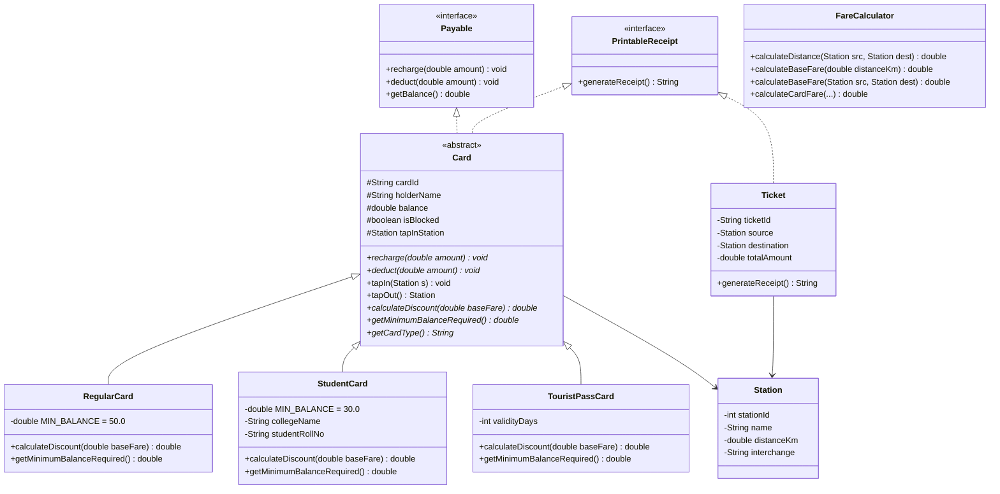

# Mumbai Metro One (MMOPL) - Smart Card & Fare Ticketing System
### Academic Mini-Project | Mumbai University (SE Semester 3 - OOPM)

---

## 📌 Project Overview
The **Mumbai Metro Smart Card & Fare Ticketing System** is a desktop application developed in Java (Swing + Core OOP) that simulates the Automated Fare Collection (AFC) and passenger ticketing infrastructure of **Mumbai Metro Line 1 (Versova - Andheri - Ghatkopar corridor)**.

The system handles dynamic slab-based fare computation, automated passenger tap-in / tap-out gate entry/exit validation, student and commuter concessions, multithreaded rush-hour surge management, digital QR ticket generation, and audit logging.

---

## 🎯 Mumbai University OOPM Syllabus Mapping

| Syllabus Requirement | How It Is Implemented in Code | Exact Source File Reference |
| :--- | :--- | :--- |
| **Abstraction & Inheritance** | Abstract base class `Card` inherited by `RegularCard`, `StudentCard`, and `TouristPassCard`. | `model/Card.java`, `model/RegularCard.java`, `model/StudentCard.java` |
| **Polymorphism (Runtime)** | Overridden method `calculateDiscount(double baseFare)` dynamically calculates 20% concession for students vs 5% for regulars. | `model/StudentCard.java`, `model/RegularCard.java` |
| **Polymorphism (Compile-time)** | Method overloading in `FareCalculator`: `calculateBaseFare(double)`, `calculateBaseFare(Station, Station)`, `calculateTokenFare(...)`. | `service/FareCalculator.java` |
| **Interfaces** | `Payable` (contract for financial deduction/recharge) and `PrintableReceipt` (contract for ASCII ticket printing). | `interfaces/Payable.java`, `interfaces/PrintableReceipt.java` |
| **User-Defined Exceptions** | 4 Custom Exception classes handling edge cases: `InsufficientBalanceException`, `MinimumBalanceException`, `InvalidStationException`, `CardBlockedException`. | `exceptions/*.java` |
| **Multithreading** | Background daemon thread `PeakHourMonitorThread` extending `Thread` that monitors rush hours and dynamically adjusts fares in real time. | `threads/PeakHourMonitorThread.java` |
| **Thread Synchronization** | `synchronized` methods on `recharge()` and `deduct()` to prevent race conditions during concurrent transactions. | `model/Card.java` |
| **Collections Framework** | `ArrayList` for stations and transactions, `HashMap` for $O(1)$ smart card lookup, `Collections.unmodifiableList`. | `data/DataStore.java` |
| **Relational Database (RDBMS & JDBC)** | Full SQLite relational database (`mumbai_metro.db`) with Foreign Keys, 4 normalized tables (`stations`, `cards`, `tickets`, `transactions`), and dynamic SQL query console. | `data/MetroDatabaseManager.java`, `data/DataStore.java` |
| **Animation & Visual Simulation** | 60 FPS Interactive Mumbai Metro Route Visualizer (`MetroTrackCanvas`) with animated multi-carriage train, and 3D-perspective turnstile barrier gate (`AnimatedGateView`) with motorized sliding flaps. | `ui/MetroTrackCanvas.java`, `ui/AnimatedGateView.java` |
| **QR Code Engine (Pure Java)** | Custom Reed-Solomon GF(256) error correction & 2D matrix encoder generating scannable QR `BufferedImage` & PNG files. | `qr/QRCodeGenerator.java` |
| **GUI & Anti-Aliasing** | Modern Java Swing interface with LCD sub-pixel font anti-aliasing, system fonts, and rounded card UI components. | `ui/MetroAppGUI.java`, `ui/UITheme.java` |

---

## 🏛️ System Architecture & UML Class Diagram



---

## 🚉 Mumbai Metro Line 1 Stations & Fare Slabs

### Operational Metro Lines & Stations (62 Stations):
The system models all 4 operational Mumbai Metro corridors with live interchange connections:
1. **Line 1 (Blue Line) - 11.4 km (12 Stations):**
   * Versova ↔ D.N. Nagar (*Interchange Line 2A*) ↔ Azad Nagar ↔ Andheri (*Interchange Western Railway*) ↔ Western Express Highway (*Interchange Line 7*) ↔ Chakala ↔ Airport Road ↔ Marol Naka (*Interchange Line 3*) ↔ Saki Naka ↔ Asalpha ↔ Jagruti Nagar ↔ Ghatkopar (*Interchange Central Railway*)
2. **Line 2A (Yellow Line) - 18.6 km (17 Stations):**
   * Dahisar East (*Interchange Line 7*) ↔ Anand Nagar ↔ Kandarpada ↔ Mandapeshwar ↔ Eksar Road ↔ Borivali West ↔ Pahadi Eksar ↔ Kandivali West ↔ Dahanukar Wadi ↔ Valnai ↔ Malad West ↔ Lower Malad ↔ Bangur Nagar ↔ Goregaon West ↔ Oshiwara ↔ Lower Oshiwara ↔ Andheri West / D.N. Nagar (*Interchange Line 1*)
3. **Line 7 (Red Line) - 16.5 km (14 Stations):**
   * Dahisar East (*Interchange Line 2A*) ↔ Ovaripada ↔ National Park ↔ Devipada ↔ Magathane ↔ Poisar ↔ Akurli / Kandivali East ↔ Kurar ↔ Dindoshi ↔ Aarey Colony ↔ Goregaon East ↔ JVLR (*Interchange Line 3*) ↔ Shankarwadi ↔ Gundavali / Andheri East (*Interchange Line 1 WEH*)
4. **Line 3 (Aqua Line Underground) - 33.5 km (19 Stations):**
   * Aarey JVLR (*Interchange Line 7*) ↔ SEEPZ ↔ MIDC Andheri ↔ Marol Naka (*Interchange Line 1*) ↔ CSMIA T2 Airport ↔ Sahar Road ↔ CSMIA T1 Airport ↔ Santacruz ↔ Bandra Colony ↔ BKC (Bullet Train) ↔ Dharavi ↔ Dadar Metro ↔ Siddhivinayak ↔ Worli ↔ Mahalaxmi ↔ Mumbai Central Metro ↔ CSMT Metro ↔ Churchgate Metro ↔ Cuffe Parade

### Fare Calculation Slabs:
* **0 to 3 km:** ₹10.00
* **3 to 6 km:** ₹20.00
* **6 to 9 km:** ₹30.00
* **9 to 12 km:** ₹40.00
* **12 to 15 km:** ₹50.00
* **15 to 18 km:** ₹60.00
* **18 to 21 km:** ₹70.00
* **21 to 24 km:** ₹80.00
* **24 to 27 km:** ₹90.00
* **27 to 30 km:** ₹100.00
* **> 30 km:** ₹110.00
* **Peak Hour Rush Surcharge:** +₹5.00
* **Student Concession:** 20% discount on final fare

---

## 🚀 How to Build and Run the Project

### Method 1: Using the Automated Build Script (Recommended)
We provide a standalone build script that automatically handles compilation, packaging, and fallback between Maven and direct `javac`:

```bash
# Build and package the executable JAR:
./build.sh

# Run the application:
./build.sh run

# Run automated academic verification tests:
./build.sh test

# Clean build artifacts:
./build.sh clean
```

> **For Windows (College Lab PCs):** Simply run `build.bat` or `build.bat run`.

### Method 2: Using Maven Directly
```bash
# 1. Build and package into JAR
mvn clean package -o

# 2. Run the executable JAR
java -jar target/mumbai-metro-ticketing-1.0.0.jar
```

### Method 3: Running Unit Tests
```bash
# Run automated academic verification tests
java -cp target/classes com.mumbaimetro.test.MetroSystemTest
```

---

## 🎤 Top Viva Questions & Prepared Answers

**Q1. Why did you use an Abstract Class for `Card` instead of an Interface?**
> *Answer:* `Card` has common state (fields like `cardId`, `holderName`, `balance`, `issueDate`) and common concrete behavior (like `recharge()`, `deduct()`, `tapIn()`), but `calculateDiscount()` and `getMinimumBalanceRequired()` vary by card type. Interfaces cannot hold mutable instance state, making an Abstract Class the ideal OOP design choice.

**Q2. Where is Multithreading used in your project?**
> *Answer:* `PeakHourMonitorThread` runs in the background concurrently without blocking the Swing Event Dispatch Thread (UI). It monitors peak rush hours and dynamically modifies fare surcharges, notifying the GUI using a listener callback pattern wrapped in `SwingUtilities.invokeLater()`.

**Q3. How do you prevent race conditions when two gates or top-up kiosks access a card simultaneously?**
> *Answer:* By marking critical balance-modifying methods (`recharge()` and `deduct()`) as `synchronized`. This ensures mutual exclusion on the Card object's intrinsic monitor lock.

**Q4. Explain your Custom Exceptions and why you created them.**
> *Answer:* We created `InsufficientBalanceException`, `MinimumBalanceException`, `InvalidStationException`, and `CardBlockedException` by extending `java.lang.Exception`. This allows us to handle metro-specific business errors cleanly with contextual data (such as current balance vs required amount) rather than throwing generic exceptions.
