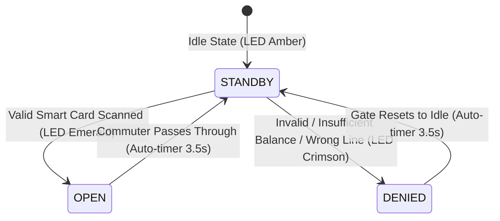

# 🚪 Automated Fare Collection (AFC) Turnstile Gate Simulator

The **Automated Fare Collection (AFC)** system simulates modern motorized flap barrier turnstiles found at physical Mumbai Metro stations. It integrates hardware state simulation, RFID reader physics, and atomic database transaction processing.

---

## 🕹️ Turnstile State Machine

The gate simulator operates under three primary physical states:



### Visual & Physical Feedback
1. **`STANDBY`**: Flap barriers closed; overhead LED indicator emits an amber glow (`◈ GATE STANDBY - TAP SMART CARD`).
2. **`OPEN`**: Flap barriers retract outward (`open-left` and `open-right` CSS keyframe transforms); LED switches to emerald green (`● ACCESS GRANTED - PROCEED`); audio-visual celebratory confetti particles burst across the screen.
3. **`DENIED`**: Flap barriers remain locked shut; LED flashes crimson red (`✕ ACCESS DENIED`); an informative reason (e.g. insufficient balance, line mismatch, or blocked card) appears on the display.

---

## 🔄 Two-Phase Gate Processing Protocol

### Phase 1: Tap-In Gate (Entry Turnstile)
When a commuter taps their card at an entry station:
1. **Account Integrity Check:**
   - Verifies the card exists and is **not blocked** (`CardBlockedException`).
   - Ensures the card is not already marked as **in transit** (`IllegalStateException`). Double tap-in without tapping out is rejected.
2. **Minimum Balance Verification:**
   - Evaluates card-specific threshold polymorphically:
     $$\text{Balance} \ge \text{card.getMinimumBalanceRequired()}$$
     (₹50 for Regular cards, ₹30 for Student cards, ₹0 for Tourist passes).
   - If balance is deficient, [`MinimumBalanceException`](file:///home/rushabhp/Projects/CNN/src/main/java/com/mumbaimetro/exceptions/MinimumBalanceException.java) is thrown.
3. **Transit State Transition:**
   - Card state is updated: `inTransit = true`, `tapInStation = station`, `tapInTime = currentTime`.
   - The updated card state is committed to SQLite, and access is granted.

### Phase 2: Tap-Out Gate (Exit Turnstile & Deduction)
When a passenger taps out at their destination station:
1. **Transit Verification:**
   - Confirms the card is currently marked `inTransit`. Tapping out without a prior tap-in is rejected (`IllegalStateException`).
2. **Same-Line Constraint Validation:**
   - The exit station must be on the **same line** as the tap-in station:
     ```java
     if (!origin.getLineCode().equals(exitStation.getLineCode())) {
         throw new InvalidStationException("Cannot select stations from two different lines! Exit station must be on the same Metro line as entry.");
     }
     ```
   - In the frontend UI ([`TurnstileGate.jsx`](file:///home/rushabhp/Projects/CNN/frontend/src/components/TurnstileGate.jsx)), exit station options are automatically filtered to only display stations matching the commuter's tap-in corridor.
3. **Same-Station Tap-Out Rule:**
   - If a commuter taps out at the identical station where they tapped in, an [`InvalidStationException`](file:///home/rushabhp/Projects/CNN/src/main/java/com/mumbaimetro/exceptions/InvalidStationException.java) is raised.
4. **Distance & Dynamic Fare Deduction:**
   - Distance between origin and exit station is computed.
   - Base fare slab is looked up and rush-hour surcharges (+₹5.00) are added if peak hour is active.
   - Subclass polymorphic discount is calculated and deducted from balance via `card.deduct(finalFare)`.
   - If balance is insufficient to cover the journey, an [`InsufficientBalanceException`](file:///home/rushabhp/Projects/CNN/src/main/java/com/mumbaimetro/exceptions/InsufficientBalanceException.java) is thrown and the gate remains closed until recharged.
5. **State Reset & Audit Trail:**
   - `inTransit` is reset to `false`.
   - A relational transaction record (`CARD_JOURNEY_DEDUCTION`) is committed to the SQLite database.
