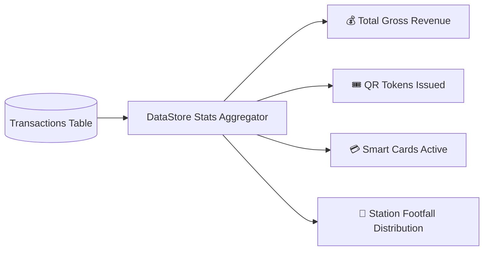

# 📊 Analytics Dashboard & Traffic Insights

The **Analytics Dashboard** provides transit operations staff with real-time operational metrics, financial reporting, and network traffic distribution across all 7 metro corridors.

---

## 📈 Key Dashboard Metrics

The dashboard aggregates operational data from `mumbai_metro.db` through [`DataStore.java`](file:///home/rushabhp/Projects/CNN/src/main/java/com/mumbaimetro/data/DataStore.java):



### 1. Financial Performance
- **Gross Revenue:** Real-time summation of all `TOKEN_PURCHASE` and `CARD_RECHARGE` transactions.
- **Average Fare per Commuter:** Mean journey revenue evaluated across single, return, and discount tiers.
- **Peak Hour Surge Revenue:** Financial impact of the ₹5.00 congestion surcharge during morning and evening rush hours.

### 2. Fleet & Network Counters
- **Active Operational Stations:** 90 stations across 7 lines.
- **Cards In Transit:** Commuters currently between tap-in and tap-out barriers.
- **Blocked Accounts:** Accounts placed on security hold.

---

## 🚦 Station Footfall Tracking

Station entries are automatically tracked whenever an AFC turnstile tap-in occurs or a QR ticket originates from a station:

```java
public synchronized Map<String, Integer> getStationTrafficSummary() {
    Map<String, Integer> traffic = new HashMap<>();
    String sql = "SELECT source_station, COUNT(*) as count FROM transactions " +
                 "WHERE source_station != '-' GROUP BY source_station ORDER BY count DESC";
    // Returns frequency map sorted by volume
    return traffic;
}
```

### High-Density Corridor Nodes:
- **Andheri (Line 1):** Western Railway suburban local interchange.
- **Ghatkopar (Line 1):** Central Railway suburban local interchange.
- **Marol Naka (Line 1 / Line 3):** Underpass connecting Blue and Aqua underground lines.
- **D.N. Nagar / Andheri West (Line 1 / Line 2A):** Connecting western suburban elevated routes.
- **Dahisar East (Lines 2A, 7, 9):** Northern intersection hub.

---

## 📜 Transaction Audit Trail

Every financial movement or passenger transit event is immutably appended to the `transactions` table with an ISO timestamp:

| Type | Description | Effect |
| :--- | :--- | :--- |
| `TOKEN_PURCHASE` | Commuter bought single/return QR token. | Revenue increased by token fare. |
| `CARD_ISSUED` | New physical RFID card initialized. | Revenue increased by initial deposit. |
| `CARD_RECHARGE` | Balance topped up via kiosk or online. | Card balance & gross revenue increased. |
| `CARD_JOURNEY_DEDUCTION` | AFC exit turnstile tap-out. | Card balance decreased by final fare. |

### Real-Time Presentation
In both the React Dashboard (`AnalyticsDashboard.jsx`) and Thymeleaf Dashboard (`dashboard.html`), transactions are displayed in a responsive table with status badges (`SUCCESS`, `FAILED`), monospace IDs, and currency formatting.
