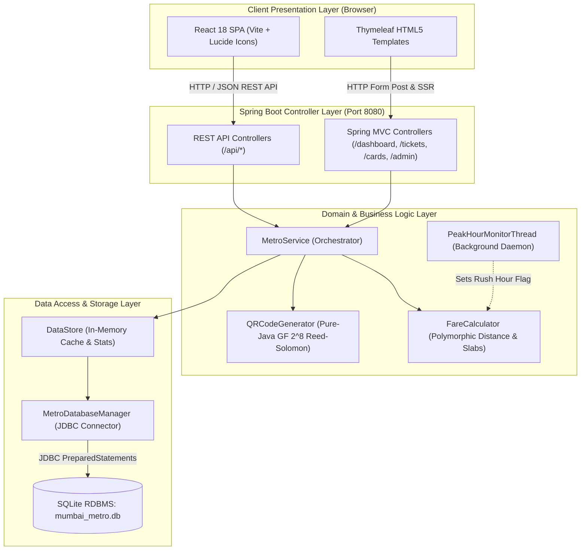

# 🏛️ System Architecture & Web MVC Design

The **Mumbai Metro Smart Card & Fare Ticketing System** is engineered as a decoupled, layered enterprise web application. It combines a robust **Java 17 / Spring Boot 3.3.5** backend, an embedded **SQLite Relational Database (RDBMS)**, a pure-Java mathematical QR encoding engine, and a reactive **React 18 Single Page Application (SPA)** with Vite.

---

## 📐 High-Level Architecture Diagram



---

## 🧱 Architectural Layers

### 1. Presentation Layer (Frontend)
- **React 18 SPA (`/frontend`)**:
  - Built with Vite, leveraging Lucide React iconography and pure CSS animations.
  - Interactive SVG-like metro map with line-based node grouping and clickable route selection.
  - 3D motorized turnstile gate animation illustrating physical barrier states (`STANDBY`, `OPEN`, `DENIED`).
  - Holographic smart cards with dynamic gradient badges and live balance indicators.
  - Real-time live fare previews with debounced REST API lookups.
- **Thymeleaf HTML5 Views (`src/main/resources/templates`)**:
  - Provides traditional server-side rendered pages (`layout.html`, `dashboard.html`, `tickets.html`, `cards.html`, `admin.html`).
  - Flash attributes (`RedirectAttributes`) communicate validation messages and ticket receipts across redirects.

### 2. Controller Layer (API & Routing)
- **REST API Controllers (`com.mumbaimetro.api`)**:
  - [`StationApiController.java`](file:///home/rushabhp/Projects/CNN/src/main/java/com/mumbaimetro/api/StationApiController.java): Station lookups, line filters, and fare calculation previews.
  - [`TicketApiController.java`](file:///home/rushabhp/Projects/CNN/src/main/java/com/mumbaimetro/api/TicketApiController.java): Single & return QR ticket issuing with Base64 QR payloads.
  - [`CardApiController.java`](file:///home/rushabhp/Projects/CNN/src/main/java/com/mumbaimetro/api/CardApiController.java): Card creation, recharge, NFC tap-in, and tap-out deductions.
  - [`AdminApiController.java`](file:///home/rushabhp/Projects/CNN/src/main/java/com/mumbaimetro/api/AdminApiController.java): Database statistics, transaction audit logs, and arbitrary SQL execution.
  - [`StatusApiController.java`](file:///home/rushabhp/Projects/CNN/src/main/java/com/mumbaimetro/api/StatusApiController.java): Background daemon status and rush-hour mode indicators.
- **Spring MVC Controllers (`com.mumbaimetro.controller`)**:
  - Serves classic Thymeleaf templates and handles form-based submissions.

### 3. Business Service Layer
- **[`MetroService.java`](file:///home/rushabhp/Projects/CNN/src/main/java/com/mumbaimetro/service/MetroService.java)**: Central application coordinator validating AFC operations, enforcing account status rules, committing transactions, and updating persistent state.
- **[`FareCalculator.java`](file:///home/rushabhp/Projects/CNN/src/main/java/com/mumbaimetro/service/FareCalculator.java)**: Encapsulates distance calculation, line isolation validation, dynamic slab lookups, passenger multipliers, and peak-hour surcharges.
- **[`QRCodeGenerator.java`](file:///home/rushabhp/Projects/CNN/src/main/java/com/mumbaimetro/qr/QRCodeGenerator.java)**: Implements Galois Field $GF(2^8)$ mathematics and Reed-Solomon polynomial division to generate scannable QR tokens without third-party dependencies.

### 4. Background Workers & Multithreading
- **[`PeakHourMonitorThread.java`](file:///home/rushabhp/Projects/CNN/src/main/java/com/mumbaimetro/threads/PeakHourMonitorThread.java)**:
  - Spawns as a background daemon managed through Spring's lifecycle (`MetroConfig.java`).
  - Evaluates system time every 15 seconds to identify morning (08:00–11:30) and evening (17:30–21:00) peak rush windows.

### 5. Data Access & Relational Persistence
- **[`DataStore.java`](file:///home/rushabhp/Projects/CNN/src/main/java/com/mumbaimetro/data/DataStore.java)**: Singleton thread-safe repository cache managing in-memory indices for station lookup and rapid traffic analytics.
- **[`MetroDatabaseManager.java`](file:///home/rushabhp/Projects/CNN/src/main/java/com/mumbaimetro/data/MetroDatabaseManager.java)**: Direct JDBC management layer creating and querying `mumbai_metro.db` via normalized tables, foreign keys, and parameterized queries.

---

## 🔄 End-to-End Sequence: QR Ticket Booking

```mermaid
sequenceDiagram
    autonumber
    actor Passenger as Commuter (Browser)
    participant API as TicketApiController
    participant Srv as MetroService
    participant Calc as FareCalculator
    participant QR as QRCodeGenerator
    participant DB as MetroDatabaseManager

    Passenger->>API: POST /api/tickets/book {source: 1, destination: 12, passengers: 2}
    API->>Srv: bookSingleJourneyToken(src, dest, passengers, isReturn, isPeakHour)
    Srv->>Calc: calculateDistance(src, dest)
    Note over Calc: Validates same-line constraint
    Calc-->>Srv: 11.4 km
    Srv->>Calc: calculateTokenFare(src, dest, passengers, isReturn, isPeakHour)
    Calc-->>Srv: ₹80.00
    Srv->>DB: saveTicket(ticket)
    DB-->>Srv: Ticket persisted in SQLite
    Srv->>QR: generateQRCodeBase64(qrPayload, scale)
    Note over QR: Reed-Solomon GF(256) encoding
    QR-->>Srv: data:image/png;base64,...
    Srv->>DB: logTransaction(txn)
    Srv-->>API: Ticket + QR payload + ASCII receipt
    API-->>Passenger: HTTP 200 JSON with QR Image & Receipt
```
