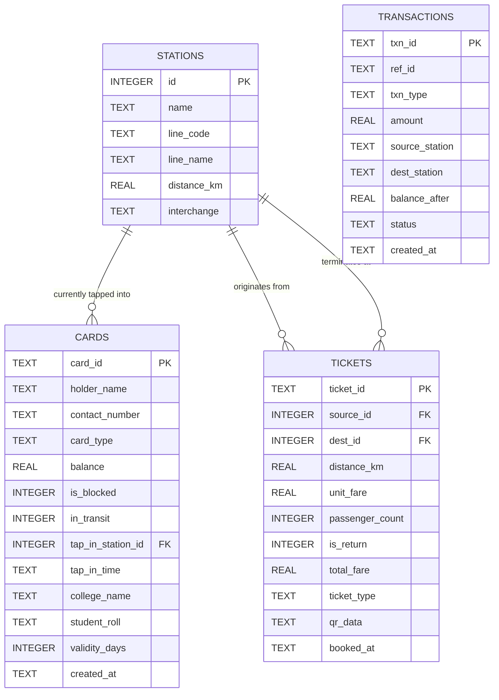

# 🗄️ Relational Database (RDBMS) & SQL Console

The application uses an embedded **SQLite Relational Database Management System** (`mumbai_metro.db`) accessed via Java Database Connectivity (JDBC). This design provides a self-contained, portable, and zero-configuration relational persistence layer with full ACID transactional compliance.

---

## 🗂️ Relational Entity-Relationship Diagram (ERD)



---

## 📋 Database Schema & DDL Definitions

All tables and indices are automatically initialized upon startup in [`MetroDatabaseManager.java`](file:///home/rushabhp/Projects/CNN/src/main/java/com/mumbaimetro/data/MetroDatabaseManager.java):

### 1. `stations` Table
Stores all 90 operational stations across 7 corridors.
```sql
CREATE TABLE stations (
    id INTEGER PRIMARY KEY,
    name TEXT NOT NULL,
    line_code TEXT NOT NULL,
    line_name TEXT NOT NULL,
    distance_km REAL NOT NULL,
    interchange TEXT DEFAULT 'None',
    UNIQUE(line_code, name)
);
```

### 2. `cards` Table
Stores issued smart cards with polymorphic type attributes, balance, and gate transit flags.
```sql
CREATE TABLE cards (
    card_id TEXT PRIMARY KEY,
    holder_name TEXT NOT NULL,
    contact_number TEXT,
    card_type TEXT NOT NULL,
    balance REAL NOT NULL DEFAULT 0.0,
    is_blocked INTEGER NOT NULL DEFAULT 0,
    in_transit INTEGER NOT NULL DEFAULT 0,
    tap_in_station_id INTEGER,
    tap_in_time TEXT,
    college_name TEXT,
    student_roll TEXT,
    validity_days INTEGER DEFAULT 0,
    created_at TEXT NOT NULL,
    FOREIGN KEY (tap_in_station_id) REFERENCES stations(id)
);
```

### 3. `tickets` Table
Records single and return journey QR tokens with distance and fare breakdowns.
```sql
CREATE TABLE tickets (
    ticket_id TEXT PRIMARY KEY,
    source_id INTEGER NOT NULL,
    dest_id INTEGER NOT NULL,
    distance_km REAL NOT NULL,
    unit_fare REAL NOT NULL,
    passenger_count INTEGER NOT NULL DEFAULT 1,
    is_return INTEGER NOT NULL DEFAULT 0,
    total_fare REAL NOT NULL,
    ticket_type TEXT NOT NULL,
    qr_data TEXT,
    booked_at TEXT NOT NULL,
    FOREIGN KEY (source_id) REFERENCES stations(id),
    FOREIGN KEY (dest_id) REFERENCES stations(id)
);
```

### 4. `transactions` Table
Maintains an immutable financial and movement audit trail.
```sql
CREATE TABLE transactions (
    txn_id TEXT PRIMARY KEY,
    ref_id TEXT NOT NULL,
    txn_type TEXT NOT NULL,
    amount REAL NOT NULL,
    source_station TEXT,
    dest_station TEXT,
    balance_after REAL NOT NULL DEFAULT 0.0,
    status TEXT NOT NULL,
    created_at TEXT NOT NULL
);
```

---

## 🔌 JDBC Connection Management & PreparedStatements

### Connection URL
Connections are established using the official Xerial SQLite JDBC driver:
```java
private static final String DB_URL = "jdbc:sqlite:mumbai_metro.db";

public static Connection getConnection() throws SQLException {
    Connection conn = DriverManager.getConnection(DB_URL);
    try (Statement stmt = conn.createStatement()) {
        stmt.execute("PRAGMA foreign_keys = ON;"); // Enforce referential integrity
    }
    return conn;
}
```

### Parameterized Queries (Preventing SQL Injection)
All business operations bind values through `PreparedStatement`:
```java
String sql = "INSERT OR REPLACE INTO cards (card_id, holder_name, contact_number, card_type, " +
             "balance, is_blocked, in_transit, tap_in_station_id, tap_in_time, college_name, " +
             "student_roll, validity_days, created_at) VALUES (?, ?, ?, ?, ?, ?, ?, ?, ?, ?, ?, ?, ?)";

try (Connection conn = getConnection();
     PreparedStatement ps = conn.prepareStatement(sql)) {
    ps.setString(1, card.getCardId());
    ps.setString(2, card.getHolderName());
    ps.setString(3, card.getContactNumber());
    ps.setString(4, card.getClass().getSimpleName());
    ps.setDouble(5, card.getBalance());
    ps.setInt(6, card.isBlocked() ? 1 : 0);
    ps.setInt(7, card.isInTransit() ? 1 : 0);
    // ...
    ps.executeUpdate();
}
```

---

## 💻 Web SQL Administration Console

The application includes an embedded **RDBMS Management Console** accessible in both React (`AdminConsole.jsx`) and Thymeleaf (`admin.html`):

### Features:
1. **Live SQL Execution Engine:** Allows executing arbitrary SQL queries (`SELECT`, `INSERT`, `UPDATE`, `PRAGMA`) with tabular output.
2. **Metadata Introspection:** Inspects live database file path, table counts, station counts, card counts, and total transaction volume.
3. **Preset Analytical Queries:**
   - Station footfall analysis:
     ```sql
     SELECT source_station, COUNT(*) AS trips FROM transactions WHERE source_station != '-' GROUP BY source_station ORDER BY trips DESC LIMIT 10;
     ```
   - High-value smart card commuter balances:
     ```sql
     SELECT card_id, holder_name, card_type, balance FROM cards ORDER BY balance DESC LIMIT 5;
     ```
   - Revenue breakdown by transaction type:
     ```sql
     SELECT txn_type, COUNT(*) AS count, SUM(amount) AS total_revenue FROM transactions GROUP BY txn_type;
     ```
