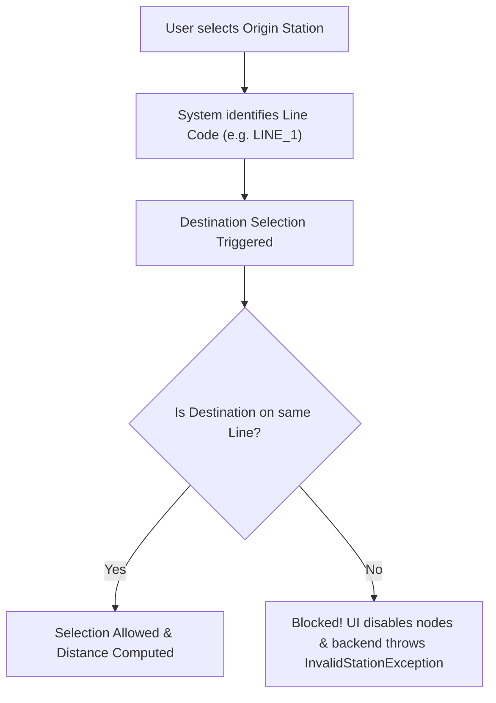

# 🚇 Metro Network Corridors & Line Isolation Architecture

The system accurately simulates all **7 operational Mumbai & Navi Mumbai Metro corridors**, spanning **90 stations** with distance tracking and station characteristics.

---

## 🗺️ Operational Corridors Overview

| Line Code | Line Name | Color Code | Length (km) | Station Count | Terminals |
| :--- | :--- | :--- | :--- | :--- | :--- |
| `LINE_1` | **Line 1 (Blue Line)** | `#2563eb` | 11.4 km | 12 | Versova ↔ Ghatkopar |
| `LINE_2A` | **Line 2A (Yellow Line)** | `#eab308` | 18.6 km | 17 | Dahisar East ↔ Andheri West (D.N. Nagar) |
| `LINE_7` | **Line 7 (Red Line)** | `#ef4444` | 16.5 km | 14 | Dahisar East ↔ Gundavali (WEH) |
| `LINE_9` | **Line 9 (Red Extension)** | `#f43f5e` | 6.2 km | 4 | Dahisar East ↔ Kashigaon |
| `LINE_3` | **Line 3 (Aqua Line Underground)** | `#06b6d4` | 34.5 km | 27 | Aarey JVLR ↔ Cuffe Parade |
| `LINE_2B` | **Line 2B (Yellow Extension)** | `#f59e0b` | 5.5 km | 5 | Mandale ↔ Diamond Garden (Chembur) |
| `NMM_1` | **Navi Mumbai Line 1** | `#8b5cf6` | 11.1 km | 11 | Belapur CBD ↔ Pendhar (Taloja) |

---

## 🔒 Same-Line Selection Rule (Line Isolation)

### Business Rule Rationale
In real-world metro transit operations, different corridors frequently operate with separate signaling, specialized ticketing boundaries, independent concessionaires, and dedicated automated fare gates. Booking a direct single-journey QR token or tapping in/out across two disconnected lines without passing through designated physical interchange gates causes:
1. **Unverifiable Trajectories:** Passenger route validation cannot accurately compute track mileage.
2. **Turnstile Hardware Rejections:** Optical turnstiles on one line cannot settle tickets issued under another corridor's jurisdiction.
3. **Fare Settlement Conflicts:** Fare allocations across different operating entities become inconsistent.

### Technical Enforcement
Cross-line selection is strictly prohibited across the application stack:



#### 1. Interactive SVG Map (`InteractiveMap.jsx`)
- As soon as an Origin station is selected, station nodes on any different line are dynamically dimmed (`opacity: 0.35`, `filter: grayscale(60%)`, `cursor: not-allowed`).
- If clicked, a toast notification alerts the user:
  ```text
  Cannot select stations from two different lines! Origin is on Line 1 (Blue). Please select a destination on the same line.
  ```
- A dedicated **"Clear Selection"** button allows passengers to reset and select an origin from a different line at any time.

#### 2. Ticket Booking Form (`TicketBooking.jsx`)
- The **Metro Line Selector** synchronizes with the origin station.
- The **Destination Station** dropdown strictly renders only stations belonging to the selected origin's line (`st.lineCode === currentOrigin.lineCode && st.stationId !== currentOrigin.stationId`).
- Changing the origin station automatically updates the destination station to a valid station on that same line.

#### 3. Backend Service & Exception Enforcement
In [`FareCalculator.java`](file:///home/rushabhp/Projects/CNN/src/main/java/com/mumbaimetro/service/FareCalculator.java#L25-L29):
```java
if (!src.getLineCode().equals(dest.getLineCode())) {
    throw new InvalidStationException("Cannot select stations from two different lines (" 
            + src.getLineName() + " and " + dest.getLineName() + "). Both stations must be on the same Metro line.");
}
```
In [`MetroService.java`](file:///home/rushabhp/Projects/CNN/src/main/java/com/mumbaimetro/service/MetroService.java#L197-L200):
```java
if (!origin.getLineCode().equals(exitStation.getLineCode())) {
    throw new InvalidStationException("Cannot select stations from two different lines (" 
            + origin.getLineName() + " and " + exitStation.getLineName() + ")! Exit station must be on the same Metro line as entry.");
}
```

---

## 📊 Station Entity Data Model

The [`Station.java`](file:///home/rushabhp/Projects/CNN/src/main/java/com/mumbaimetro/model/Station.java) class encapsulates station metadata:

```java
public class Station implements Serializable, Comparable<Station> {
    private final int stationId;
    private final String name;
    private final double distanceKm;
    private final String lineCode;
    private final String lineName;
    private final String interchange;
    // ...
}
```

### Relational Table Schema
In SQLite, stations are persisted with a composite unique constraint to allow interchange nodes sharing identical names across corridors:
```sql
CREATE TABLE stations (
    id INTEGER PRIMARY KEY,
    name TEXT NOT NULL,
    line_code TEXT NOT NULL,
    line_name TEXT NOT NULL,
    distance_km REAL NOT NULL,
    interchange TEXT DEFAULT 'None',
    UNIQUE(line_code, name)
);
```

### Distance Computation
Since journeys are constrained to the same line, distance computation is straightforward and exact:
$$\text{Distance} = |\text{Destination Distance (km)} - \text{Origin Distance (km)}|$$
This value is fed into the dynamic fare slabs calculation engine.
