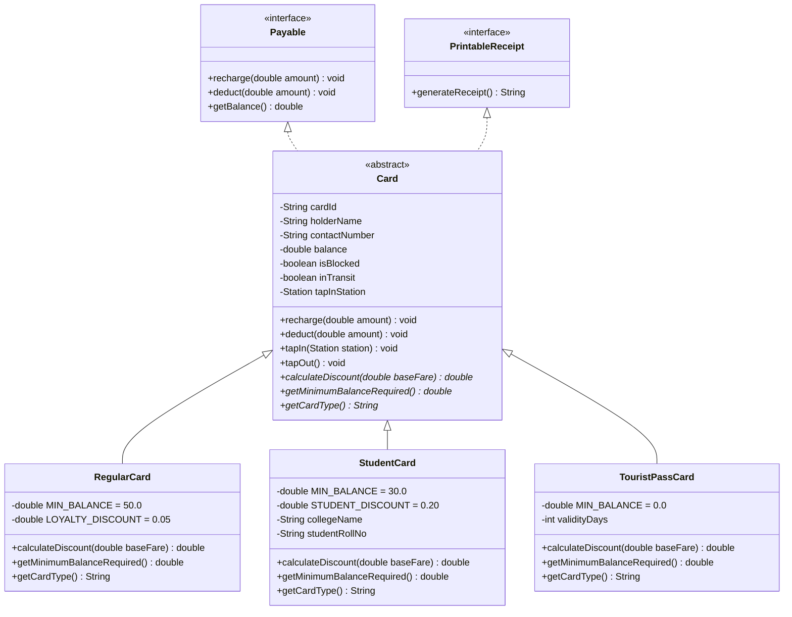
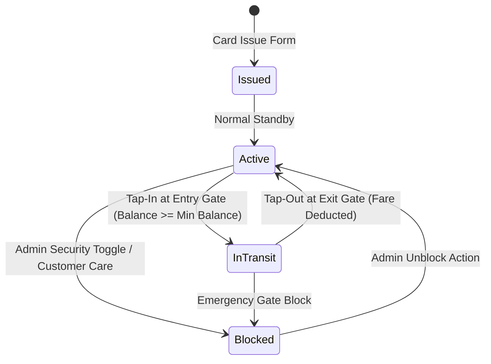

# 💳 Smart Card System & Polymorphic Architecture

The Smart Card module manages reusable electronic RFID transit passes. It demonstrates core Object-Oriented Programming (OOP) principles—including abstraction, inheritance, runtime polymorphism, interface decoupling, thread synchronization, and persistent lifecycle management.

---

## 🏛️ Class Hierarchy Diagram



---

## 🃏 Smart Card Subtypes & Polymorphic Rules

### 1. [`RegularCard.java`](file:///home/rushabhp/Projects/CNN/src/main/java/com/mumbaimetro/model/RegularCard.java)
- **Target Audience:** Everyday working commuters.
- **Minimum Balance:** Requires at least **₹50.00** on card to initiate tap-in at an entry turnstile.
- **Discount Scheme:** Overrides `calculateDiscount(double baseFare)`. Applies a **5% loyalty concession** on longer journeys costing $\ge$ ₹30.00.
```java
@Override
public double calculateDiscount(double baseFare) {
    if (baseFare >= 30.0) {
        return baseFare * LOYALTY_DISCOUNT_PERCENT; // 5% off
    }
    return 0.0;
}
```

### 2. [`StudentCard.java`](file:///home/rushabhp/Projects/CNN/src/main/java/com/mumbaimetro/model/StudentCard.java)
- **Target Audience:** College and institute students.
- **Minimum Balance:** Concession threshold of **₹30.00** at entry tap-in.
- **Discount Scheme:** Overrides `calculateDiscount(double baseFare)` to guarantee a flat **20% concession** on all journeys.
- **Additional Attributes:** Tracks `collegeName` and `studentRollNo`.

### 3. [`TouristPassCard.java`](file:///home/rushabhp/Projects/CNN/src/main/java/com/mumbaimetro/model/TouristPassCard.java)
- **Target Audience:** Short-term visitors and tourists.
- **Minimum Balance:** Requires **₹0.00** minimum balance because travel is prepaid via a flat pass rate.
- **Discount Scheme:** Overrides `calculateDiscount(double baseFare)` to return **100% discount** (`return baseFare`), meaning journey fares are entirely waived while the pass remains within its active validity period.

---

## 🔒 Thread Safety & Financial Operations

Smart cards in a multi-gate transit station can be scanned simultaneously across different turnstiles or recharged while in use. To prevent race conditions and lost update anomalies:

```java
public synchronized void recharge(double amount) {
    if (amount <= 0) {
        throw new IllegalArgumentException("Recharge amount must be positive.");
    }
    this.balance += amount;
}

public synchronized void deduct(double amount) throws InsufficientBalanceException {
    if (amount <= 0) {
        throw new IllegalArgumentException("Deduction amount must be positive.");
    }
    if (this.balance < amount) {
        throw new InsufficientBalanceException(this.cardId, amount, this.balance);
    }
    this.balance -= amount;
}
```

### Card State Lifecycle


---

## 💾 Relational Persistence in SQLite

Cards are persisted in `mumbai_metro.db` with relational constraints linking to active stations:

```sql
CREATE TABLE cards (
    card_id TEXT PRIMARY KEY,
    holder_name TEXT NOT NULL,
    contact_number TEXT,
    card_type TEXT NOT NULL,
    balance REAL NOT NULL DEFAULT 0.0,
    is_blocked INTEGER NOT NULL DEFAULT 0,
    in_transit INTEGER NOT NULL DEFAULT 0,
    tap_in_station_id INTEGER,
    tap_in_time TEXT,
    college_name TEXT,
    student_roll TEXT,
    validity_days INTEGER DEFAULT 0,
    created_at TEXT NOT NULL,
    FOREIGN KEY (tap_in_station_id) REFERENCES stations(id)
);
```

Every tap-in, tap-out, or recharge updates the record in SQLite and logs an audit record in the `transactions` table.
